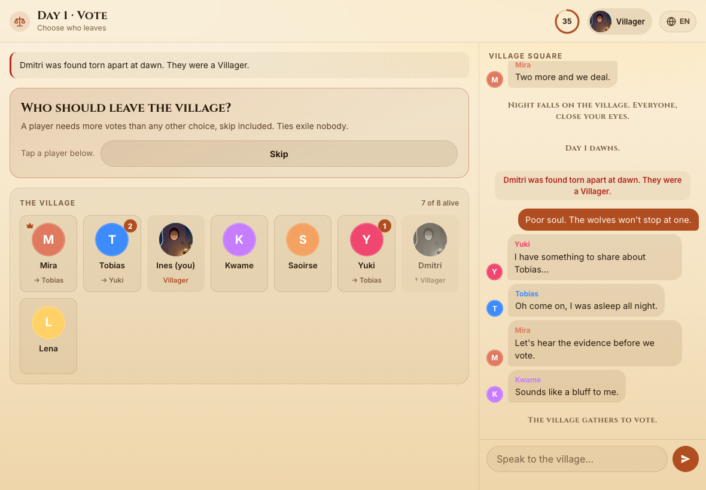
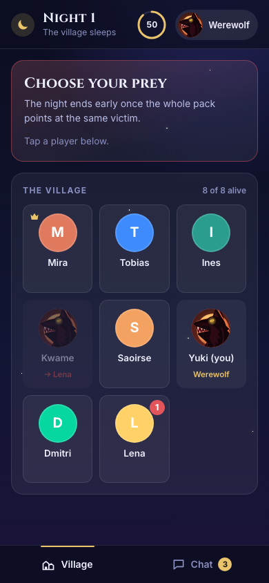
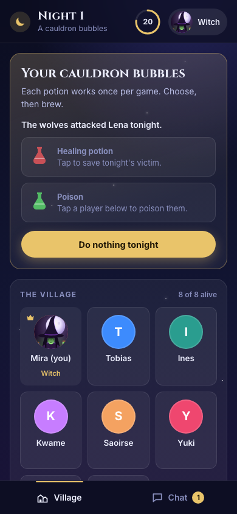
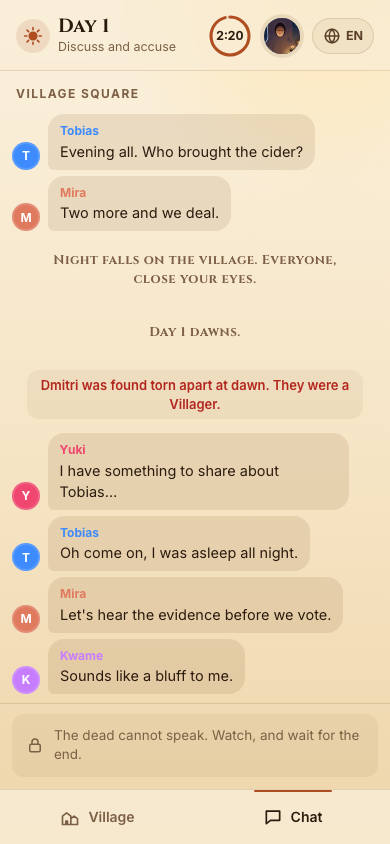
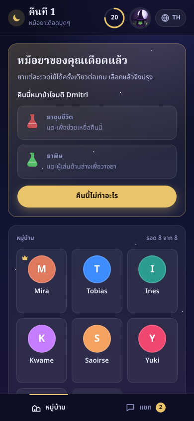
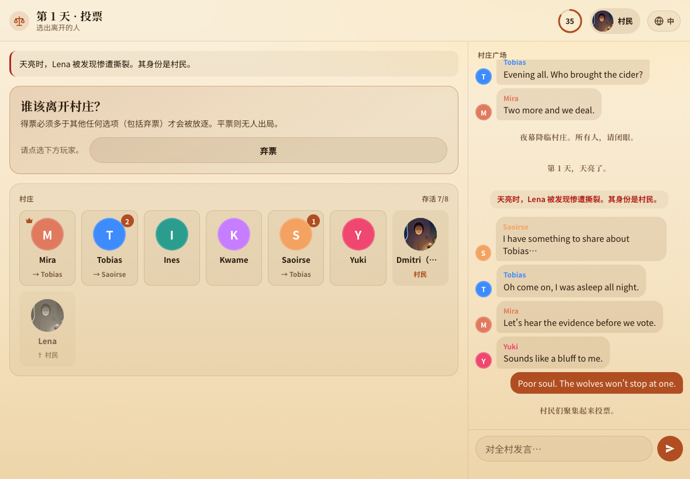
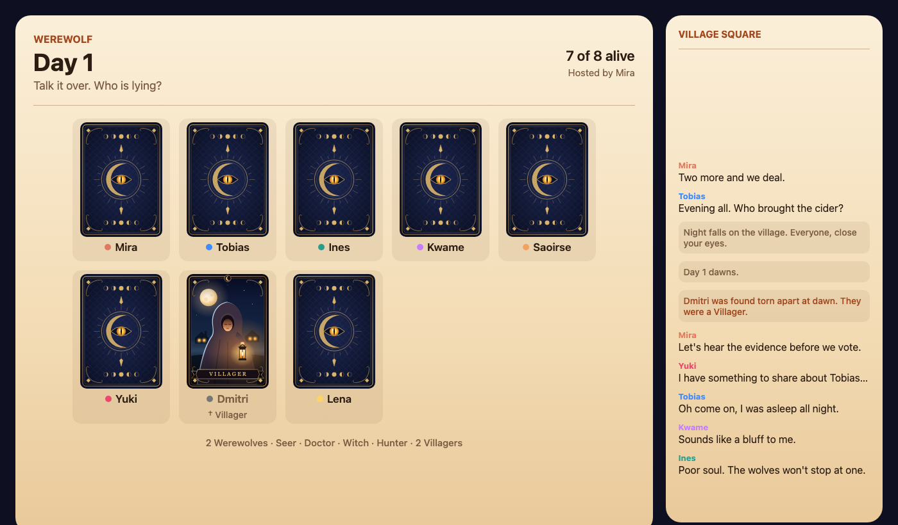

# Werewolf for Drawdy

A party game of lies, hunches, and accusations, played right on your Drawdy board with friends.

## What is this game?

Werewolf is a classic social deduction game. A few players are secretly **werewolves** hiding among the **villagers**. Nobody knows who is who, except the wolves, who know each other.

The game switches between two phases:

- **Night 🌙** Everyone's eyes are "closed". The wolves quietly pick someone to attack. Villagers with special powers use them in secret.
- **Day ☀️** The village wakes up and finds out who died. Everyone talks, argues, and points fingers, then votes to exile the person they think is a wolf.

**The village wins** if they find and exile every wolf.
**The wolves win** if they survive until there are as many wolves as villagers.

The fun is in the talking: wolves have to lie convincingly, and villagers have to figure out who is lying.

## Who can you be?

When the game starts, each player gets a secret role card. Only you can see yours.

| Role | Side | What you do |
| ---- | ---- | ----------- |
| 🐺 Werewolf | Wolves | Each night, agree with the other wolves on someone to attack. By day, blend in. |
| 🧑‍🌾 Villager | Village | No special power. Listen carefully, and vote out the wolves. |
| 🔮 Seer | Village | Each night, secretly learn whether one player is a werewolf. |
| 🩺 Doctor | Village | Each night, protect one player from the wolves (not the same one twice in a row). |
| 🧪 Witch | Village | Has one potion to save a victim and one poison to kill someone, each usable once. |
| 🏹 Hunter | Village | When the Hunter dies, they take one player down with them. |

Once you die, you can watch everything and see everyone's role, but you can't talk anymore. No hints from beyond the grave!

## How to play

You need **4 to 16 players**, all on the same Drawdy board, each with the Werewolf extension installed.

1. **One person starts the game.** Click the wolf icon in the toolbar and press **Gather the village**. A game table appears on the board. This person is the host and should keep the board open until the game ends.
2. **Everyone else joins.** Click the same wolf icon and press **Take a seat**.
3. **The host deals.** The host can adjust the roles and the pace, and can choose to just narrate instead of playing. Then press **Deal the cards**.
4. **Play!** Your role card flips over, and the first night begins. Follow the prompts on your screen: tap a player to choose, then confirm.
5. **Game over.** When one side wins, every card is turned over so everyone can see who was who.

Works on phones and computers. There's a village chat for daytime arguing, and a private chat only the wolves can see at night.

## Play in your language

The game speaks **English**, **ไทย (Thai)**, and **中文 (Chinese)**. Each player picks their own language with the globe button, so friends can play together in different languages.

## Is it fair?

Yes. Roles and night actions are encrypted, so other players can't peek, and dead players really can't sneak messages into the chat. The only person whose computer knows every role is the host, because it runs the game. Pick a host everyone trusts, or let the host narrate instead of playing.

---

Card art is original, drawn for this game. Developers: see [DEVELOPMENT.md](DEVELOPMENT.md) for how it works, permissions, and build steps.
